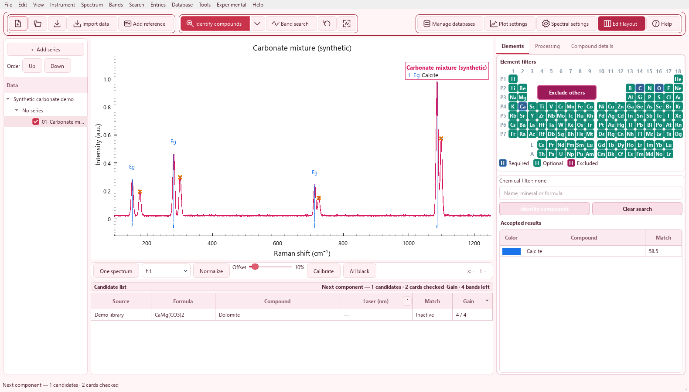

# Raman Phase Finder

**Raman Phase Finder** is an open-source desktop program for identifying phases from Raman spectra. Compare measured spectra with reference profiles or published band tables, review what each candidate explains, and save the analysis as a portable project.

## Download

- **Windows 10/11 (64-bit):** [Download Raman Phase Finder 1.0.1 (.exe)](https://github.com/ABKuznetsov/Raman_Phase_Finder/releases/download/v1.0.1/Raman_Phase_Finder_Setup_1.0.1.exe).
- **macOS:** [Download Raman Phase Finder 1.0.0 (.pkg)](https://github.com/ABKuznetsov/Raman_Phase_Finder/releases/download/v1.0.0/Raman_Phase_Finder_macOS_1.0.0.pkg).
- **Linux:** [Run from source](#run-from-source) with Python 3.11 or 3.12.

See [all releases and release notes](https://github.com/ABKuznetsov/Raman_Phase_Finder/releases).

## Main window



*Synthetic example: calcite is accepted and dolomite is suggested for the remaining bands.*

| Area | What you can do |
| --- | --- |
| Project tree | Select the active spectrum for search, check other spectra to display, and organize measurements into series. |
| Spectrum plot | Compare individual or stacked spectra. Turn reference profiles, peak lines, shift ticks, and mode labels on or off independently. |
| Elements | Filter the database by composition. Left-click to require an element, right-click to exclude it, and use **Allow others** to broaden the search. |
| Candidate list | Preview a reference with one click. Double-click to accept it. Use **Match** for the first pass and **Gain** to see which candidates explain bands still unassigned. |
| Accepted results | Toggle overlays, change their colors, or remove individual references or clear the list. |
| Compound details | Inspect the sample or reference metadata, band assignments, and matches. |

## Typical workflow

1. **Import and prepare.** Load one or more Raman spectra in TXT, XY, CSV, JCAMP-DX or XLSX. Use smoothing, background subtraction, despiking or normalization where appropriate. Some instrument formats, including SPC and WDF, use the optional format readers.
2. **Search.** Run **Identify compounds** against the enabled reference libraries. Narrow results with the element table, or use **Band search** to review and edit the positions used for matching.
3. **Review.** Compare the experimental bands with the reference positions and assignments before accepting a candidate. In automatic search, **Gain** ranks candidates for the remaining bands after a candidate is accepted.
4. **Save or export.** Save the work as an `.rpff` project, or export the current figure as PNG, JPG, layered SVG or PDF.

**Match** and **Gain** help prioritize references for inspection. They are not probabilities or quantitative phase fractions.

## Reference cards from the literature

A published band table is enough to build a searchable reference. **A full spectrum is optional.** Use **Add reference** to enter band positions and any reported intensities, vibrational assignments, or symmetry labels. Record the DOI, the source table or figure, and the measurement conditions when known. Keep reported, estimated, and inferred assignments distinct.

- Start with the [JSON reference template](reference_template.json), or edit a card directly in the application.
- Use **Add reference → Load / attach → Load RREF / JSON** to open a shared card and save it to the user library.
- Export selected cards as `.rref` or JSON from the reference table context menu. You can also compare several references in one plot and save the comparison without importing a measured spectrum.

## Reference data sources

Use **Manage databases** to download or index external libraries and choose which ones to include in a search.

| Source | Reference data |
| --- | --- |
| [RRUFF](https://www.rruff.net/about/download-data/) | Raman reference spectra for minerals. |
| [Raman Open Database (ROD)](https://solsa.crystallography.net/rod/) | A public collection of experimental and calculated Raman spectra. |
| [OpenSpecy](https://www.openspecy.org/) | Raman libraries that include polymers and other materials. |
| [Oulu CRD](https://archive.materialscloud.org/records/0m9r0-g3486) | Computational Raman spectra. |
| User library | Your measurements and band lists from publications. |

Third-party databases are not bundled. Follow each provider's terms and citation guidance. Downloaded and indexed libraries can be searched without an internet connection. Set `IR_RAMAN_OFFLINE=1` to skip release checks.

## Installation and updates

### Windows

Run the installer with administrator approval. It installs the program into `%ProgramFiles%\Raman Phase Finder`, creates Start menu shortcuts, and offers an optional desktop shortcut. The first setup may need internet access for Python and packages.

The program reuses the per-user Python environment at `%LocalAppData%\Sci\env`. Downloaded databases, user cards and settings are stored under `%LocalAppData%\Sci\apps\Raman Phase Finder`, outside the installation folder.

The app checks for updates after opening. You can also check from **Help → Check for updates**. Starting with 1.0.1, **Download and install** downloads the Windows installer with progress, verifies its SHA-256 checksum, and launches it. **Install 1.0.1 manually when upgrading from 1.0.0**, which can only open the release page.

### macOS

Open the 1.0.0 package and follow the installer, then launch **Raman Phase Finder** from Applications. The launcher creates or reuses a per-user Sci environment on first run. The 1.0.1 binary release is for Windows.

### Run from source

With Python 3.11 or 3.12 available, run `setup_env.bat` and `run_finder.bat` on Windows. On Linux:

```sh
bash setup_env.sh
bash run_finder.sh
```

## Project files

Portable `.rpff` projects store the spectra, analysis state, selected references and plot settings needed to reopen the work. Exported figures and the full external databases are separate. Older `.irff` projects are not directly compatible: open them with the original program or import the original Raman data into a new project.

## Author and license

Developed by Artem B. Kuznetsov, Institute of Geology and Mineralogy SB RAS. For powder diffraction, see the companion [XRD Phase Finder](https://github.com/ABKuznetsov/XRD_Analysis_Toolkit).

The source code is licensed under the [MIT License](LICENSE).
